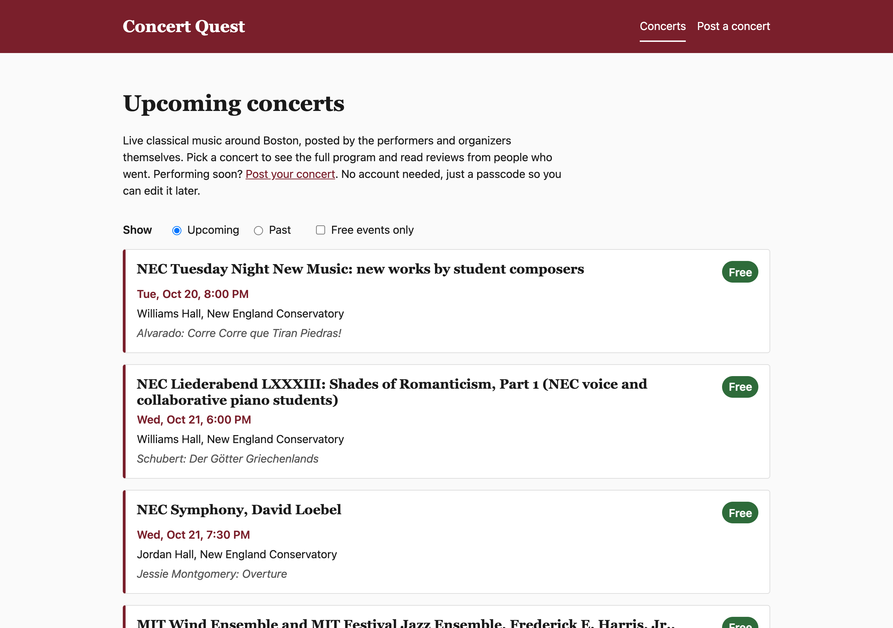

# Concert Quest

Find live classical music in Boston. CS5610 Project 2: Node + Express + MongoDB
backend with a vanilla JavaScript, client-side rendered frontend.

- **Authors:** Julian Bowen and Jerith Gurusubburam
- **Class link:** https://johnguerra.co/classes/webDevelopment_online_fall_2026/index.html
- **Live site:** https://concert-quest.onrender.com (free tier: the first load after
  ~15 idle minutes takes 30–60 seconds)
- **Design document:** [docs/DESIGN.md](docs/DESIGN.md)
- **Demo video:** TODO
- **Slides:** TODO

## Project Objective

Boston's classical music scene is spread across the BSO, conservatories,
churches, and small ensembles, and newcomers don't know where to look. Free
student recitals are especially hard to find, and performers have few ways to
reach people outside their own circles.

Concert Quest puts it in one place: performers and organizers post upcoming
concerts, and people who went leave reviews. No account is needed. Each post is
protected by a passcode its author chooses, and an admin passcode lets a
moderator fix or remove anything.

## Screenshot



## Instructions to Build

Requires Node 22.9+ and a MongoDB database (Atlas or local).

```bash
npm install
cp .env.example .env   # then fill in MONGO_URI and ADMIN_PASSCODE
npm run seed           # optional: load real Boston concerts from backend/seed-data.json
npm run dev            # http://localhost:3000, restarts on save
```

`npm run seed` is safe to re-run: it updates the concerts it added before and
leaves user posts (and reviews) alone. Seeded concerts can only be edited with
the admin passcode.

Before committing:

```bash
npm run format  # Prettier, writes in place
npm run check   # Prettier + ESLint, read-only
```

## How to Use

- **Find a concert:** the home page lists upcoming concerts, soonest first.
  Check **Free events only** to see free concerts, or switch to **Past** to
  see concerts that already happened. Filters are kept in the URL, so you can
  share or bookmark a filtered list.
- **See details:** click a concert for the full date, venue, price, program,
  and ticket link.
- **Post a concert:** click **Post a concert**, fill in the form, and choose a
  passcode. Leave the price blank if you don't know it, or check **Free
  event**.
- **Edit or delete a concert:** on its page, click **Edit concert** (enter
  your passcode on the form) or **Delete concert** (enter it in the dialog).
  Deleting a concert also deletes its reviews.
- **Moderate:** the admin passcode (`ADMIN_PASSCODE`) works in place of any
  poster's passcode.
- **Read and write reviews:** on a concert's page, scroll to Reviews to read
  what past attendees thought. To leave one, fill in your name, a 1–5 rating,
  and a comment, and choose a passcode. You'll need it later to edit or delete
  your review (or an admin passcode can do it on your behalf).

## Project Structure

```
backend/
  server.js           Express app: serves frontend/ and mounts /api routes
  db/connection.js    Mongo connector (the only file that reads MONGO_URI)
  db/concerts.js      concerts collection (Julian Bowen)
  db/reviews.js       reviews collection (Jerith Gurusubburam)
  routes/concerts.js  /api/concerts CRUD (Julian Bowen)
  routes/reviews.js   /api/reviews CRUD (Jerith Gurusubburam)
  passcode.js         poster/admin passcode hashing and check, shared by both routers
  seed.js             npm run seed: loads seed-data.json (Julian Bowen)
  seed-data.json      real Boston concerts, each with its official sourceUrl
frontend/
  index.html          concert list with Upcoming/Past and free filters
  concert-form.html   post / edit a concert
  concert.html        concert detail, reviews, review form, passcode dialog
  css/                base.css + one file per component
  js/                 api.js, passcode-dialog.js, one entry module per page;
                      concert.js loads the concert and hands it to
                      concert-details.js (Julian) and the reviews module (Jerith)
docs/DESIGN.md        design document
```

## Use of GenAI Tools

**Julian Bowen** used Claude Code (Anthropic's Claude Opus 5.5) as a pair
programmer for the concerts side. It helped plan the data shape and division of
work, wrote first drafts of the shared passcode module, the concerts API, the
concert form, home page list, and detail page, and the seed script, and wrote
throwaway tests (jsdom and an in-memory MongoDB) to check them. It also
researched the seed concerts, each checked against the presenter's official
page (kept as `sourceUrl` in `seed-data.json`), and helped with deploying to
Render and Atlas. I reviewed and merged each change through a pull request.
Commits it helped write are marked `Co-Authored-By: Claude`.

**Jerith Gurusubburam** used Claude Code throughout to implement the reviews
feature: the db/reviews.js data layer and routes/reviews.js API (mirroring the
existing concerts module's conventions), and the reviews UI on concert.html
(list, post, inline edit/delete with passcode checks). I reviewed each diff
before committing, manually tested the full flow (including edge cases like
wrong passcodes and empty states) against a throwaway in-memory MongoDB,
incorporated feedback from Julian's code review (reload-after-post ordering,
accessibility labels, button styling, and prompt wording), then re-verified the
review fixes with an automated headless-browser test before merging.

## Checklist

Tracking the assignment rubric.

- [ ] Design document (description, personas, user stories, mockups): mockup
      images still need adding to `docs/mockups/`
- [x] Accomplishes all approved requirements: concerts and reviews both done
- [x] Usable, with instructions: in-app intro + How to Use, including reviews
- [x] Useful to a real user: real, sourced Boston concerts
- [x] ESLint config, no errors
- [x] Code organized: each page its own file, DB separate, CSS in folders
- [x] JS organized in modules (DB connector, API client)
- [x] Client-side rendering with vanilla JS only
- [x] At least one form
- [x] Deployed on a public server
- [x] 2 Mongo collections with full CRUD: concerts and reviews, both end to end
- [x] Node + Express
- [x] Formatted with Prettier
- [x] Standard tags only (no `div` buttons; passcode prompt uses `<dialog>`)
- [x] CSS organized by module
- [x] README: author, class link, objective, screenshot, build instructions
- [x] No exposed secrets (`.env` is gitignored, `.env.example` committed)
- [x] `package.json` listing dependencies
- [x] MIT license
- [x] No leftover unused code
- [ ] Google Form submission
- [ ] Short public narrated video
- [ ] Code frozen 24 hours before class
- [x] ES modules only, no `require`
- [x] No Mongoose, no template engines
- [ ] Code review completed

## License

[MIT](LICENSE)
